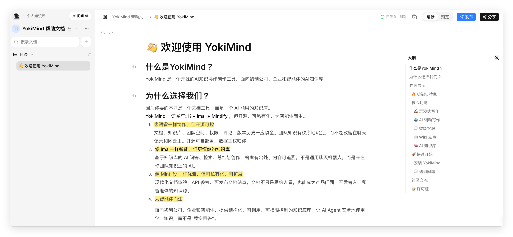
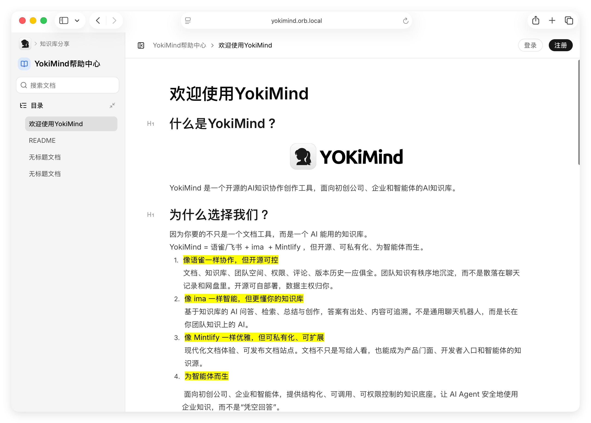

YokiMind 是一个开源的AI知识协作创作工具，面向初创公司、企业和智能体的AI知识库。

# 为什么选择我们 ？

因为你要的不只是一个文档工具，而是一个 AI 能用的知识库。  
YokiMind = 语雀/飞书 + ima  + Mintlify ，但开源、可私有化、为智能体而生。

1. **像语雀一样协作，但开源可控** <br/>文档、知识库、团队空间、权限、评论、版本历史一应俱全。团队知识有秩序地沉淀，而不是散落在聊天记录和网盘里。开源可自部署，数据主权归你。
2. **像 ima 一样智能，但更懂你的知识库** <br/>基于知识库的 AI 问答、检索、总结与创作，答案有出处、内容可追溯。不是通用聊天机器人，而是长在你团队知识上的 AI。
3. **像 Mintlify 一样优雅，但可私有化、可扩展** <br/>现代化文档体验、可发布文档站点。文档不只是写给人看，也能成为产品门面、开发者入口和智能体的知识源。
4. **为智能体而生** <br/>面向初创公司、企业和智能体，提供结构化、可调用、可权限控制的知识底座。让 AI Agent 安全地使用        企业知识，而不是“凭空回答”。

# 界面展示

**1. 沉浸式写作**



**2. AI辅助写作**


**3. 分享知识库**




**4. 发布 Wiki 站点**


**5. AI智能客服**


## 🔥 功能与特色

### ✍️ 沉浸式写作

专注、干净的编辑体验。所见即所得的编辑器，支持大纲导航、快捷键、专注模式，让你把注意力放在内容本身。

### 🤖 AI 辅助写作

在写作过程中随时调用 AI——续写、改写、总结、翻译、生成大纲。AI 理解当前知识库上下文，产出与你的业务一致，而不是泛泛而谈。

### 💬 智能客服

把知识库变成能对外的问答入口。基于 RAG 检索与引用溯源，回答客户、售前与内部咨询，每条答案都可点击跳转到原文出处，可嵌入网站或独立部署。

### 📖 Wiki 站点

一键把空间或目录发布为公开文档站点。自动生成导航、目录与搜索，适合产品手册、帮助中心和技术博客。

### 🧠 AI 知识库

整个系统的大脑。导入文档后自动解析、分块、嵌入并建立索引，支持混合检索（向量 + 关键词 + 元数据过滤）与多模型接入。提供标准 **MCP 协议**，Claude、GPT 等智能体可直接调用。

## 🚀 快速开始

### 安装 YokiMind

你需要一台支持 Docker 20.x 以上版本的 Linux 系统来安装 YokiMind。

使用 root 权限登录你的服务器，然后执行以下命令。 

```bash
git clone https://gitee.com/geesmart/yokimind.git
cd yokimind/install
./install.sh
```

根据命令提示的选项进行安装，命令执行过程将会持续几分钟，请耐心等待，可以查看安装日志

通过 `http://<IP>:<PORT>`进行访问 ;


## 💬 遇到问题 &amp; 反馈

如在使用产品过程中遇到问题，可通过以下方式联系作者：


## 📝 许可证

本项目采用 GNU Affero General Public License v3.0 (AGPL-3.0) 许可证。这意味着：

- 你可以自由使用、修改和分发本软件
- 你必须以相同的许可证开源你的修改
- 如果你通过网络提供服务，也必须开源你的代码
- 商业使用需要遵守相同的开源要求

